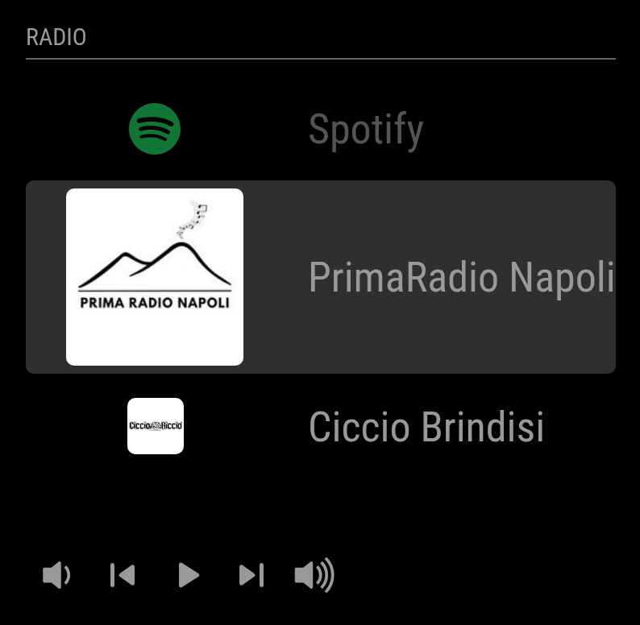
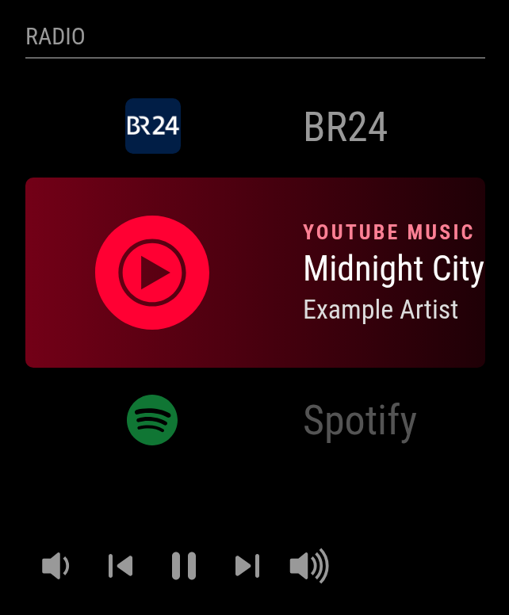
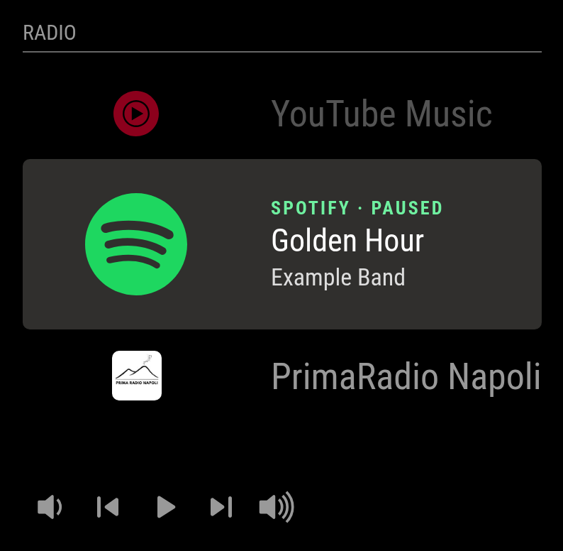

# MMM-MplayerRadio-Advanced

Internetradio für [MagicMirror²](https://magicmirror.builders/) mit **Spotify Connect und YouTube Music als Einträgen
im Senderkarussell**. Fork von [MMM-MplayerRadio](https://github.com/Tom-Hirschberger/MMM-MplayerRadio)
von Thomas Hirschberger.

🇬🇧 [English](README.md) – dort steht auch die vollständige Referenz aller Grundoptionen.

| Radio | YouTube Music läuft | Spotify pausiert |
|---|---|---|
|  |  |  |

## Neu gegenüber MMM-MplayerRadio

- **Spotify Connect und YouTube Music im Karussell.** Läuft etwas über eine dieser Quellen, springt das Karussell
  auf den Eintrag und zeigt Cover, Titel und Interpret; die Tasten des Moduls steuern dann diese Quelle
  (zurück / Pause-Weiter / vor). Endet die Wiedergabe, geht es zurück zum letzten Sender.
- **Fertige Audio-Dienste** in [`extras/audio`](extras/README.md): ein Spotify-Connect-Lautsprecher (go-librespot)
  und ein „Streamen auf“-Ziel für YouTube / YouTube Music, in den Apps jeweils als „MagicMirror“.
  Startet eine Quelle, werden die anderen gestoppt – die Soundkarte spielt nie zwei Dinge gleichzeitig.
- **Nie zwei Streams gleichzeitig:** Befehle werden nacheinander abgearbeitet, doppelte ignoriert. Ist die
  Spiegel-Seite in einem zweiten Browser offen, liefert MagicMirror jeden Befehl doppelt, was früher zwei Player startete.
- [`extras/magicmirror-docker`](extras/README.md#magicmirror-image-with-vlc): MagicMirror-Image mit VLC für das
  karsten13-Docker-Setup
- Übersetzungen (Deutsch, Englisch)

Das Modul kann neben dem Original installiert werden, es hat einen eigenen Namen.

## Installation

```bash
cd ~/MagicMirror/modules
git clone https://github.com/meni555/MMM-MplayerRadio-Advanced.git
```

Danach einen Player installieren (empfohlen: VLC), wie in der englischen Referenz unter „Installation → System“
beschrieben, oder für Docker das [MagicMirror-Image mit VLC](extras/README.md#magicmirror-image-with-vlc) verwenden.

### Umstieg von MMM-MplayerRadio

`module: "MMM-MplayerRadio"` in `module: "MMM-MplayerRadio-Advanced"` ändern und Wrapper-Pfade wie
`./modules/MMM-MplayerRadio/scripts/vlcWrapper.bash` in `./modules/MMM-MplayerRadio-Advanced/scripts/vlcWrapper.bash`.
Alle anderen Optionen und Notifications bleiben gleich. Eigenes CSS muss die Klasse `.MMM-MplayerRadio-Advanced` nutzen.

## Zusätzliche Optionen

| Option | Standard | Bedeutung |
|---|---|---|
| `externalSources` | `["youtube", "spotify"]` | Externe Quellen im Karussell in dieser Reihenfolge; `[]` schaltet sie ab |
| `showExternalWhenIdle` | `true` | Quellen auch ohne Wiedergabe als gedimmte Einträge zeigen |
| `externalNames` | `{youtube: "YouTube Music", spotify: "Spotify"}` | Anzeigenamen |
| `externalIcons` | `simple-icons:youtubemusic` / `simple-icons:spotify` | [Iconify](https://icon-sets.iconify.design/)-Icons, wenn kein Cover da ist |
| `externalControl` | `http://127.0.0.1:8099` / `http://127.0.0.1:3678` | Steuer-APIs von ytcast und go-librespot (siehe Extras) |
| `pauseIcon` | `ic-round-pause` | Icon der Pause-Taste |

### Notification `RADIO_EXTERNAL`

Die Audio-Dienste aus `extras/audio` senden sie über [MMM-Remote-Control](https://github.com/Jopyth/MMM-Remote-Control).
Andere Quellen können sie genauso nutzen:

```json
{"active": true, "source": "spotify", "playing": true, "title": "…", "artist": "…", "cover": "https://…"}
{"active": false, "source": "spotify"}
```

## Fernbedienung

Passend dazu: [magicmirror-control](https://github.com/meni555/magicmirror-control), eine Web-App fürs Handy mit
Senderwahl, Lautstärke und Steuerung von Spotify / YouTube Music.

## Credits

Basiert auf [MMM-MplayerRadio](https://github.com/Tom-Hirschberger/MMM-MplayerRadio) von Thomas Hirschberger (MIT).
Spotify Connect: [go-librespot](https://github.com/devgianlu/go-librespot). YouTube-Cast:
[yt-cast-receiver](https://github.com/patrickkfkan/yt-cast-receiver), [yt-dlp](https://github.com/yt-dlp/yt-dlp), [mpv](https://mpv.io/).
Lizenz: [MIT](LICENSE).
