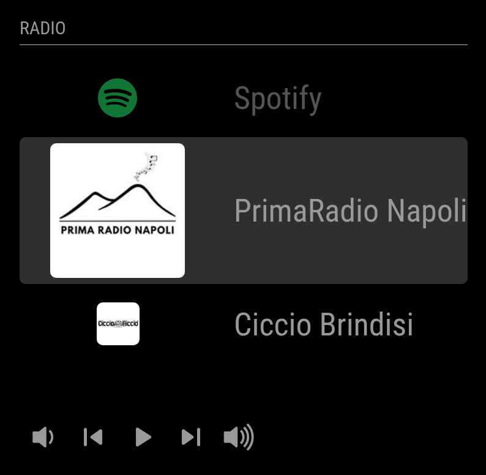
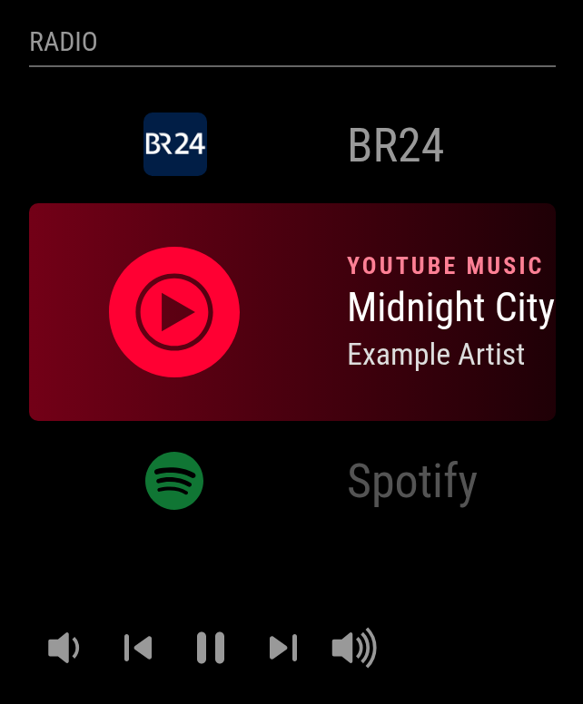
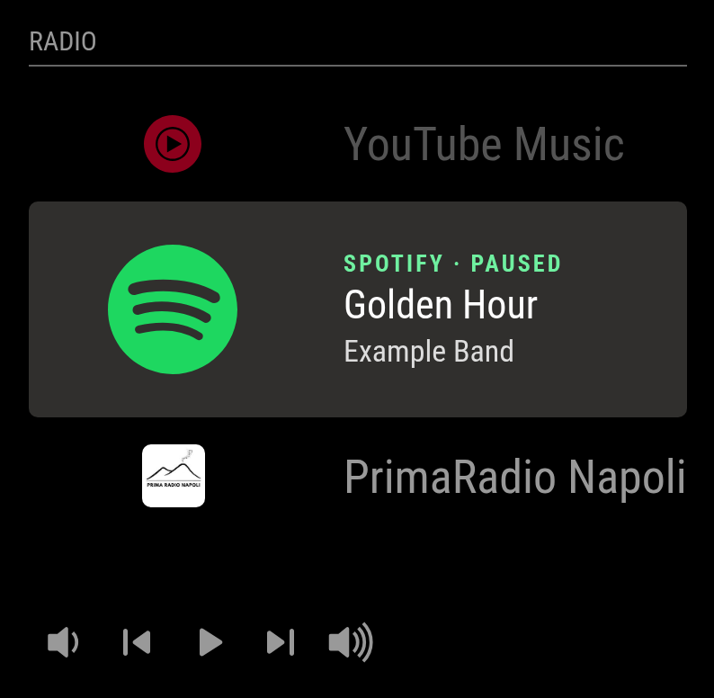

# MMM-MplayerRadio-Advanced

Internet radio for [MagicMirror²](https://magicmirror.builders/) with **Spotify Connect and YouTube Music as entries
in the station carousel**. Fork of [MMM-MplayerRadio](https://github.com/Tom-Hirschberger/MMM-MplayerRadio)
by Thomas Hirschberger.

🇩🇪 [Deutsche Anleitung](README.de.md)

| Radio | YouTube Music playing | Spotify paused |
|---|---|---|
|  |  |  |

## What is new compared to MMM-MplayerRadio

- **Spotify Connect and YouTube Music in the carousel** (Spotify playback currently does not work, see
  [Known issues](#known-issues)). When something plays through one of them, the carousel
  jumps to that entry and shows cover, title and artist; the module buttons then control that source
  (previous / pause-resume / next). When playback ends, the carousel returns to the last station.
- **Ready-to-use audio services** in [`extras/audio`](extras/README.md): a Spotify Connect speaker
  (go-librespot) and a "Cast to" target for YouTube / YouTube Music, both named "MagicMirror" in the apps.
  Starting one source stops the others, so the sound card never plays two things at once.
- **Never two streams at the same time:** commands are processed one after another and duplicates are ignored.
  With a second browser showing the mirror page, MagicMirror delivers every command twice, which used to
  start two players.
- [`extras/magicmirror-docker`](extras/README.md#magicmirror-image-with-vlc): MagicMirror image with VLC for the
  karsten13 docker setup
- Translations (English, German)

The module can be installed next to the original one, it uses its own name.

## Known issues

- **🚧 Spotify playback does not work at the moment – under work.** Playing through the Spotify Connect speaker
  "MagicMirror" (go-librespot from [`extras/audio`](extras/README.md)) currently fails. One known cause: for some
  accounts and playback contexts (mostly playlists) Spotify refuses the audio key to third-party Connect clients,
  the log then shows `failed retrieving aes key with code 1` (see
  [go-librespot #279](https://github.com/devgianlu/go-librespot/issues/279) and
  [#317](https://github.com/devgianlu/go-librespot/issues/317)). Until this is fixed, use the radio or YouTube Music.

## Installation

```bash
cd ~/MagicMirror/modules
git clone https://github.com/meni555/MMM-MplayerRadio-Advanced.git
```

Then install a player (VLC is recommended) as described in the reference part below ("Installation → System"), or use the
[MagicMirror image with VLC](extras/README.md#magicmirror-image-with-vlc) for docker.

### Switching from MMM-MplayerRadio

Change `module: "MMM-MplayerRadio"` to `module: "MMM-MplayerRadio-Advanced"` and wrapper paths such as
`./modules/MMM-MplayerRadio/scripts/vlcWrapper.bash` to `./modules/MMM-MplayerRadio-Advanced/scripts/vlcWrapper.bash`.
All other options and notifications stay the same. Custom CSS must use the class `.MMM-MplayerRadio-Advanced`.

## Additional options

| Option | Default | Description |
|---|---|---|
| `externalSources` | `["youtube", "spotify"]` | External sources in the carousel, in this order; `[]` disables them |
| `showExternalWhenIdle` | `true` | Show the sources as dimmed entries also while nothing plays through them |
| `externalNames` | `{youtube: "YouTube Music", spotify: "Spotify"}` | Display names |
| `externalIcons` | `simple-icons:youtubemusic` / `simple-icons:spotify` | [Iconify](https://icon-sets.iconify.design/) icons when there is no cover |
| `externalControl` | `http://127.0.0.1:8099` / `http://127.0.0.1:3678` | Control APIs of ytcast and go-librespot (see extras) |
| `pauseIcon` | `ic-round-pause` | Icon of the pause button |

### Notification `RADIO_EXTERNAL`

The audio services from `extras/audio` send it through [MMM-Remote-Control](https://github.com/Jopyth/MMM-Remote-Control).
Other sources can use it as well:

```json
{"active": true, "source": "spotify", "playing": true, "title": "…", "artist": "…", "cover": "https://…"}
{"active": false, "source": "spotify"}
```

## Remote control

Made to go with [magicmirror-control](https://github.com/meni555/magicmirror-control), a phone web app with
station selection, volume and Spotify / YouTube Music controls.

## Credits

Based on [MMM-MplayerRadio](https://github.com/Tom-Hirschberger/MMM-MplayerRadio) by Thomas Hirschberger (MIT).
Spotify Connect: [go-librespot](https://github.com/devgianlu/go-librespot). YouTube cast:
[yt-cast-receiver](https://github.com/patrickkfkan/yt-cast-receiver), [yt-dlp](https://github.com/yt-dlp/yt-dlp), [mpv](https://mpv.io/).
Licensed under the [MIT License](LICENSE).

# Reference (from MMM-MplayerRadio)

Everything below is the documentation of the original module and applies unchanged (with the new module name).

### Screenshots ##

#### In Action ###


### Installation ##

#### System ###

##### Mplayer ####

**I suggest to use the `vlcWrapper.bash` instead!**

Make sure you installed mplayer on your system. Simple type the following command

```bash
    mplayer
```

The output should look like

```bash
    MPlayer 1.3.0 (Debian), built with gcc-8 (C) 2000-2016 MPlayer Team
```

If there is something like

```bash
    -bash: mplayer: command not found
```

Install the player with

```bash
    sudo apt update && sudo apt install mplayer
```

##### Asound ####

**DEPRECATED! As of the release of Rasperry OS in December 2020 the audio system has been changed from ALSA to PulseAudio and this configuration is not needed anymore!**
I use an Hifiberry DAC device as audio output. You might need to add an asound.conf to get sound output on the mirror.
This is my file "/etc/asound.conf"

```text
    pcm.!default  {
        type hw card 0
    }
    ctl.!default {
        type hw card 0
    }
```

You can try it without an asound.conf. If you get no sound try adding this one and restart the pi.

#### Module ###

```bash
    cd ~/MagicMirror/modules
    git clone https://github.com/meni555/MMM-MplayerRadio-Advanced.git
    cd MMM-MplayerRadio-Advanced-Advanced
    npm install
```

### Configuration ##

```json5
    {
   module: "MMM-MplayerRadio-Advanced",
   header: "Radio",
   position: "top_center",
   config: {
    //autoplay: 0,
    stations: [
     {
      title: "Antenne.de",
      url: "http://play.antenne.de/antenne.m3u",
      logo: "https://upload.wikimedia.org/wikipedia/commons/a/ac/Antenne-bayern-logo.png",
     },
     {
      title: "Bayern 3",
      url: "https://streams.br.de/bayern3_1.m3u",
      logo: "https://upload.wikimedia.org/wikipedia/de/thumb/d/d3/Bayern_3.svg/200px-Bayern_3.svg.png",
     },
     {
      title: "Rock Antenne",
      url: "http://play.rockantenne.de/rockantenne.m3u",
      logo: "https://upload.wikimedia.org/wikipedia/commons/thumb/9/92/Rock_Antenne_Logo_2017.svg/200px-Rock_Antenne_Logo_2017.svg.png",
     }
    ],
   },
  },
```

#### VLC Player instead of Mplayer ###

As mentioned above `mplayer` has a lot of problems to play streams currently. My personal suggestion is to switch to VLC player instead by setting a custom command in the configuration section.
First check if VLC is installed or install it if needed:

```bash
  sudo apt update && sudo apt install -y vlc
```

Basically you only need to add two lines to the configuration (CUSTOM_COMMAND, CUSTOM_COMMAND_ARGS). Make sure to set the path of the wrapper to the path of your installation. It is `./modules/MMM-MplayerRadio-Advanced/scripts/vlcWrapper.bash` in usual installations but may be different in your case:

```js
  customCommand: "./modules/MMM-MplayerRadio-Advanced/scripts/vlcWrapper.bash",
  customCommandArgs: ["###URL###"],
```

The example configuration from above then looks like:

```json5
    {
   module: "MMM-MplayerRadio-Advanced",
   header: "Radio",
   position: "top_center",
   config: {
    customCommand: "./modules/MMM-MplayerRadio-Advanced/scripts/vlcWrapper.bash",
    customCommandArgs: ["###URL###"],
    //autoplay: 0,
    stations: [
     {
      title: "Antenne.de",
      url: "http://play.antenne.de/antenne.m3u",
      logo: "https://upload.wikimedia.org/wikipedia/commons/a/ac/Antenne-bayern-logo.png",
     },
     {
      title: "Bayern 3",
      url: "https://streams.br.de/bayern3_1.m3u",
      logo: "https://upload.wikimedia.org/wikipedia/de/thumb/d/d3/Bayern_3.svg/200px-Bayern_3.svg.png",
     },
     {
      title: "Rock Antenne",
      url: "http://play.rockantenne.de/rockantenne.m3u",
      logo: "https://upload.wikimedia.org/wikipedia/commons/thumb/9/92/Rock_Antenne_Logo_2017.svg/200px-Rock_Antenne_Logo_2017.svg.png",
     }
    ],
    displayStationsOnStartup: true
   },
  },
```

**Stream information is only provided if you use version 0.1.X and above of this module!**

If you do want to set the volume of vlc before a stream gets started you can use the `vlcPaWrapper.bash` wrapper do this.
You can set the wrapper either in the general configuration or for a single station.
To use the wrapper you first need to download and compile the `pa_volume` binary which can be found at [https://github.com/rhaas80/pa_volume](https://github.com/rhaas80/pa_volume).

```bash
cd ~/

sudo apt-get install -y make pkg-config libpulse-dev pandoc

git clone https://github.com/rhaas80/pa_volume.git
cd pa_volume/
make

sudo mv pa_volume /usr/local/sbin
sudo chmod a+x /usr/local/sbin/pa_volume
```

After this process should have the binary `pa_volume` in the directory `/usr/local/sbin`.
The first argument for the wrapper call will be the new volume, the second the stream to play.

This example will start the wrapper and plays the "Antenne Bayern" station with a volume of 50%:

```bash
./modules/MMM-MplayerRadio-Advanced/scripts/vlcPaWrapper.bash 50 "http://play.antenne.de/antenne.m3u"
```

The custom commands configuration then will look something like:

```js
  customCommand: "./modules/MMM-MplayerRadio-Advanced/scripts/vlcPaWrapper.bash",
  customCommandArgs: ["50", "###URL###"],
```

Both the `vlcWrapper.bash` and `vlcPaWrapper.bash` support adding additonal custom arguments that will be added to the vlc command line.
If you i.e. want vlc to ignore certificate errors while connecting to a https stream you can set the option `--http-no-ssl-verify` like in this example:

```js
  customCommand: "./modules/MMM-MplayerRadio-Advanced/scripts/vlcWrapper.bash",
  customCommandArgs: ["###URL###","--http-no-ssl-verify"],
```

#### XMMS2 ###

If you prefere xmms2 to play the radio streams instead of mplayer you will find an custom script "playRadio.bash" in the scripts folder. There is a example config in the examples directory, too.

#### STREAMLINK ###

If you want to listen to a stream which does not send continously you may want to use the streamlinkWrapper.bash script in the scripts directory. It supports auto reconnects. An example config can be found in the examples directory. The first option is the time to wait for the stream to send data. The second option is the time to wait between to reconnect attempts. And the third is the url of the stream.

Make sure to install streamlink i.e. with these commands:

```bash
sudo apt -y update && sudo apt -y install streamlink
```

#### HiFiBerryOS ###

There is included a wrapper to control a remote instance of HiFiBerryOS in the scripts directory now.  
Make sure to setup password-less ssh with key authentication to to the host running HiFiBerryOS first (i.e. with this tutorial [https://www.digitalocean.com/community/tutorials/how-to-configure-ssh-key-based-authentication-on-a-linux-server](https://www.digitalocean.com/community/tutorials/how-to-configure-ssh-key-based-authentication-on-a-linux-server)).  
**Make sure to use mp3 streams instead of m3u!**

The proper module configuration will look something like (replace "hifiberry.local" with the hostname or ip of the HiFiBerryOS host):

```js
  {
     module: "MMM-MplayerRadio-Advanced",
     header: "Radio",
     position: "top_center",
     config: {
       customCommand: "./modules/MMM-MplayerRadio-Advanced/scripts/hifiberryOS.bash",
       customCommandArgs: ["###URL###", "root", "hifiberry.local", "2"],
       stations: [
          {
            title: "Rock Antenne",
            url: "https://stream.rockantenne.de/rockantenne/stream/mp3",
            logo: "https://upload.wikimedia.org/wikipedia/commons/thumb/9/92/Rock_Antenne_Logo_2017.svg/200px-Rock_Antenne_Logo_2017.svg.png",
          },
       ],
     },
  },
```

In this setup the user `root` is used to connect to HiFiBerryOS (which is the default user of HiFiBerryOS) and the check if the station is still played will run all `2` seconds.

If you want to use the [MMM-Volume](https://github.com/Anonym-tsk/MMM-Volume) module to control the volume you can make use of the build in REST-API with the following configuration (and again replace "hifiberry.local" with the hostname or ip of the HiFiBerryOS host):

```js
  {
    module: "MMM-Volume",
    position: "top_left", // It is meaningless. but you should set.
    config: {
      setVolumeScript: `curl -X POST -H "Content-Type: application/json" -d '{"percent":"#VOLUME#"}' http://hifiberry.local:81/api/volume`,
      getVolumeScript: `curl -sX GET http://hifiberry.local:81/api/volume | grep -oE "[[:digit:]]+\.[[:digit:]]" | grep -oE "^[^\.]+"`,
      usePresetScript: null,
    }
  },
```

#### General ###

| Option  | Description | Type | Default |
| ------- | --- | --- | --- |
| autoplay | If you like to play a station automatically after the module starts simply specify its index (starting with 0) here | Integer | null |
| initStation | If this value is provided instead of the station with index 1 the station with this index will be selected at the start (but not played as with autplay) | Integer | null |
| stations | An array containing station opjects; Each one needs to have an title and an url; | Array | [] |
| showStations | If you do not want to see your stations but only the initial screen with the controls set this option to false | boolean | true |
| showStreamInfo | If you do not want to see the information about the current running stream (if provided) you can change this option to false | boolean | true |
| showControls | If you do not want the control bar (prev, play, stop, next) you can hide it by setting this value to false | boolean | true |
| showVolControls | If you do not want the volume up/down buttons to be visible in the control bar you can hide them by setting this value to false | boolean | true |
| showLogos | Should the logos of the stations be displayed? | boolean | true |
| showTitles | Should the titles of the stations be displayed? | boolean | true |
| stationsBeforeAndAfter | How many stations should be displayed before and after the current active one. This value is only used if "scrollableStations" is set to false. | Integer | 1 |
| scrollableStations | Should the list of stations be scrollable. If not the count of stations before and after will be displayed. | boolean | false |
| scrollToActiveStation | Should the position of the station list be adjusted to be the current active station be the first element after a station change | true |
| missingLogoUrl | If you do not provide a logo for an station this one is used | String | "./MMM-MplayerRadio-Advanced/radio-freepnglogos.png" |
| stopOnSuspend | Should the player be stopped if the module gets hidden (i.e. because the page changes)? | boolean | false |
| changeStationOnProfileChange | Should the station be changed if the profile changes and this station is not suitable for the new profile | boolean | true |
| noInfoIcon | This icon will displayed in the inital screen and if you change to a profile that has no sations assosiated. You can use any iconify icon. | String | "noto:radio" |
| previousIcon | This icon is used in the control section to switch to the previous station. It is an iconify icon, too. | String | "ic-round-skip-previous" |
| nextIcon | This icon is used in the control section to switch to the next station. It is an iconify icon, too. | String | "ic-round-skip-next" |
| stopIcon | This icon is used in the control section if the player is stopped. It is an iconify icon, too. | String | "ic-round-stop" |
| playIcon | This icon is used in the control section if the player is currently playing. It is an iconify icon, too. | String | "ic-round-play-arrow" |
| volDownIcon | This icon is used in the control section to decrease the volume. It is an iconify icon, too. | String | "bi-volume-down-fill" |
| volUpIcon | This icon is used in the control section to increase the volume. It is an iconify icon, too. | String | "bi-volume-down-fill" |
| mplayerPath | To path to the mplayer binary. If you do not know use the "which mplayer" command to find out | String | /usr/bin/mplayer |
| mplayerCache | The mplayer (can) use an cache for web based stations | Integer | 512 |
| animationSpeed | If the station changes or the stream info will be updated the change will be animated within this speed (ms) | Integer | 500 |
| customCommand | If you do not want to use mplayer you can run any other script you like. Only condition is that the scripts needs to run as long as the station is active | String | null |
| customCommandArgs | You can pass as many arguments to the customCommand as you like. "###URL###" will be replaced with the url of the station | Array | [] |

The custom commands either can be configured in the global module configuration and then will be used for all stations or it can be configured for each station individually!

#### Stations ###

| Option  | Description | Mandatory |
| ------- | --- | --- |
| title | The title of the station which will be displayed beside the logo | true |
| url | The url of the .m3u file. If you want to use an local one put it inside the public folder and use an url like "./MMM-MplayerRadio-Advanced/YOUR_FILE.m3u". | true |
| logo | The url of the logo which should be displayed for this station. If you want to use an local one use an url like "./MMM-MplayerRadio-Advanced/YOUR_LOGO_FILE". If no logo is specified the configured default logo is used instead | false |
| mplayerCache | If you like you can provide an different cache size for specific stations. i.e. because the stream is very slow or buggy | false |
| profiles | If you want this station only be visible/playable in specific profiles add the profiles to this string (i.e. "pageOne pageTwo"). If the string is missing/not set the station can be used in every profile | false |
| customCommand | If you like to run an different command special for this station you can pass it with this variable. The only condition is that the command needs to run as long as the station is active. | false |
| customCommandArgs | If you use the customCommand for this station you can pass as many argument to it as you like in this array. "###URL###" will be replaced with the url of the station | false |

### Supported Notifications ##

| Notification | Payload | Description |
| ------------ | ------- | ----------- |
| RADIO_PLAY | Either "id" or "title" or nothing | If an "id" or "name" attribute is provied the specific station is played. If nothing is specified a (for the current profile) suitable is been choosen |
| RADIO_STOP | | Stop the current station played |
| RADIO_TOGGLE | | If the radio is currently playing it stops if it is stopped it plays the current seleced station |
| RADIO_NEXT | | Switch to the next station |
| RADIO_PREVIOUS | Switch to the previous station |
